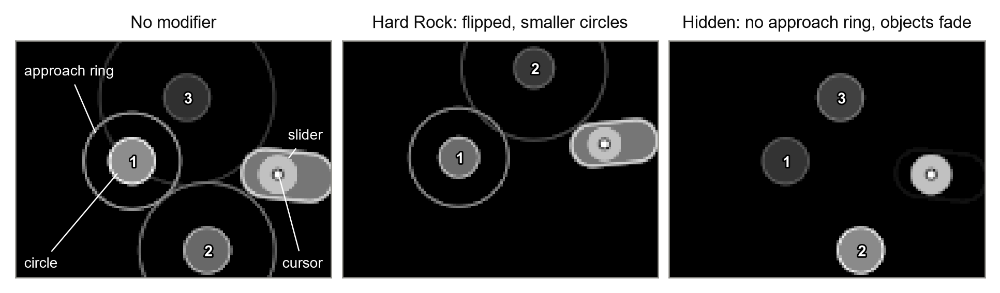
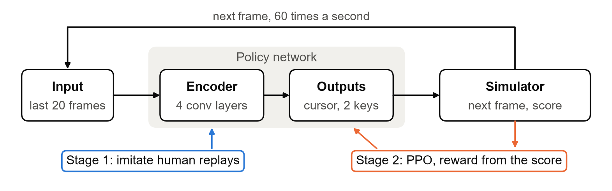
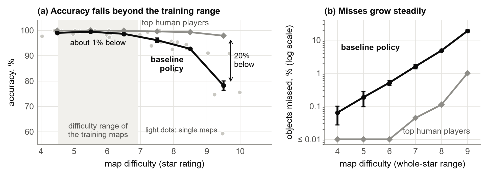
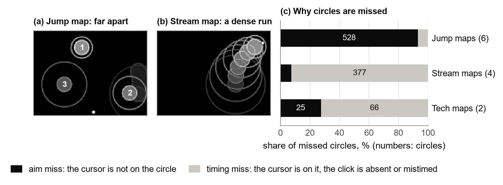
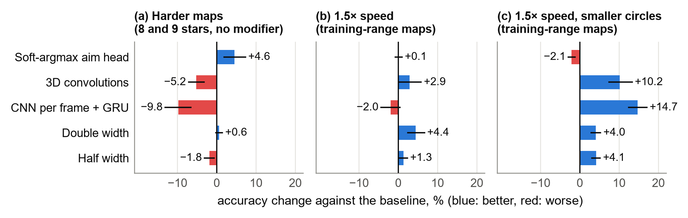
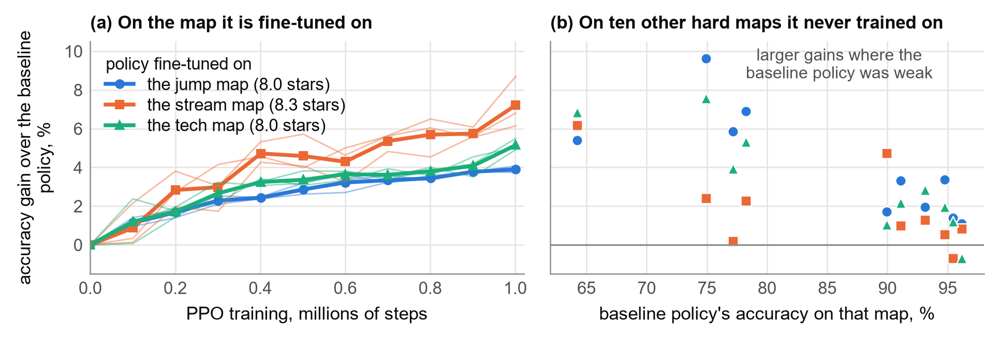
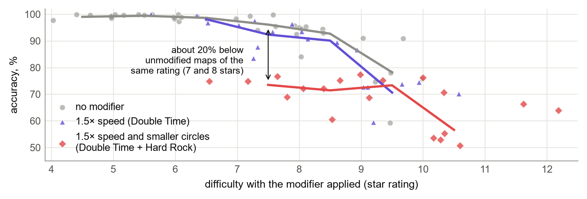
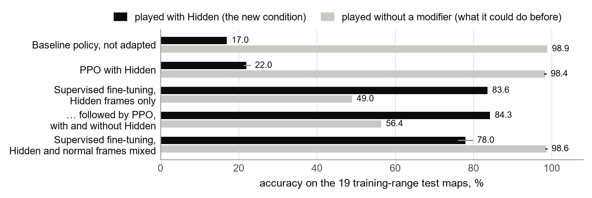

# Learning to Play osu! from Pixels: Does a Policy Trained on Easy Maps Extrapolate to Hard Ones?

SC4001 Neural Networks and Deep Learning, Group Project

Group 104 · Wang Min-Jen, Chen Liang-Yu, Chou Yu-Fan

---

## Abstract

We ask whether a policy trained by imitation can cope with tasks harder than any it was trained on.
Our testbed is the rhythm game osu!, in which every level has a published difficulty rating. We
build a simulator of the game and train a convolutional network to play from screen pixels by
imitating top players' recorded plays of medium-difficulty levels. When it plays unseen levels on
its own, it scores within 1% of top human players at the difficulties it was trained
on, and 20% below them at the hardest levels we test. The failures are specific: where targets
are far apart the cursor does not reach them, and where targets come in fast runs the clicks are
missing or mistimed. An output head that points to a position in the image helps most where targets
are far apart.
Fine-tuning with reinforcement learning on a single hard level recovers part of both, and also
improves ten other hard levels it never trained on. Two side experiments with game modifiers show
where these remedies stop working.

---

## 1. Introduction

A policy trained by imitation sees only the situations its demonstrators were in. Whether it can
still act well in situations *harder* than any it was trained on is a basic question about
generalisation. It is rarely asked directly, because "harder" is seldom a single number that can be
measured.

The rhythm game osu! provides such a number. In the game, circles appear on the screen in time with
a song, and the player must move a cursor onto each one and press a key at the right moment
(Fig. 1). Each level, called a *map*, carries a *star rating*, the game's own published difficulty
number [1]. For officially approved maps, the game's website ranks the best plays and lets
registered users download their recordings, called *replays*. Table 1 lists the few game terms this
report needs.



**Figure 1.** What the policy sees: one moment of a 4-star map, drawn by our simulator at 128 × 96
pixels. The numbers in the circles give the order in which they must be hit. *Left:* the map as
designed. The approach ring shrinks onto its circle at the moment to click. *Middle and right:* the same moment
under two of the game's modifiers (Table 1); the network itself is shown Hard Rock maps flipped
back (Section 3.2). A third modifier, Double Time, looks the same in each
frame but runs 1.5 times faster.

**Table 1.** Game terms used in this report, with the page of the game's wiki that defines each.

| Term | Meaning |
|---|---|
| Map | One level: a song with its sequence of objects to hit. |
| Star rating | The game's published difficulty number for a map [1]. Our test maps run from 4.03 to 9.99. "A 7-star map" means a rating from 7.0 to 7.99. |
| Circle, slider | The two main objects [2]. A circle is clicked once, on time. A slider is clicked and then followed with the key held down. |
| Accuracy | The game's score for one play of a map, from 0 to 100% [3]. Each object earns full, partial or no credit (300, 100, 50 or 0 points) by how close the click is to the right moment. Accuracy is the credit earned over the maximum. The human plays we use score 95 to 100%. |
| Jump, stream, tech map | Map types, from tags that players vote on [4]. Jump: objects far apart, which tests aim. Stream: fast runs of closely spaced circles, which tests timing. Tech: less common skills, in our words irregular rhythms and many sliders. |
| Modifier | An optional game setting that changes a map in a fixed way. "No modifier" is the map as designed. |
| Hard Rock | Modifier: the map is flipped vertically, circles are smaller, objects appear later and the timing tolerance is tighter [5]. |
| Double Time | Modifier: the map is played 1.5 times faster [6]. |
| Hidden | Modifier: there is no approach ring, and each object fades out before it must be hit [7]. |

We train a neural network to play osu! from screen pixels alone, by imitating replays of maps rated
4 to 6 stars, and test it on maps it has never seen, rated up to 9 stars. Our main question is how
its play degrades above the training range, why, and what recovers it. Two side experiments use the
game's modifiers, which make a map harder in one named way: by speeding it up, or by hiding the cue
that tells the player when to click.

Our contributions are:

1. **A controlled testbed.** A simulator of the game in which a policy plays whole maps on its own
   and is scored by the same code as human replays.
2. **How imitation degrades with difficulty.** The policy matches top human players inside its
   training range and falls well below them above it.
3. **Why, and which architecture helps.** On hard jump maps the policy fails at aim, on hard stream
   maps at timing. An output head built for aim helps most on hard jump maps.
4. **What reinforcement learning recovers.** Fine-tuning on one hard map improves that map and
   other hard maps, without human demonstrations of hard maps. At the same settings it barely adapts the policy
   to the Hidden modifier, where supervised fine-tuning succeeds.

To our knowledge this is the first study of how an imitation-trained osu! policy generalises across
difficulty.

## 2. Related work

**Imitation from pixels.** Training a network by supervised learning to map camera images to
actions goes back to ALVINN [8]. Its known weakness is that the network is trained on the states an
expert visited but, once deployed, visits its own, so that small errors compound [9]. Codevilla et
al. [10] show the practical form of this for driving: a strong imitation policy drops sharply on a
harder benchmark. We ask the same question along a difficulty axis that is measured, not
constructed.

**More input can hurt.** De Haan et al. [11] show that giving an imitation policy more information
can make it worse: with its previous action as input, it predicts held-out demonstrations better
and performs worse, because it learns a shortcut instead of the cause. Wen et al. [12] call the most
common shortcut, repeating the previous action, the *copycat problem*. We test this with two input
variants in Section 5.3.

**Architecture components.** Stacking recent frames as the input channels of a convolutional
network is the standard way to give a policy short-term motion [13]; our baseline does this. We
compare it with three standard alternatives. A *spatial soft-argmax*, used in robot policies to
turn image features into positions [14, 15], computes a position as the centre of mass of a heatmap
over the image, so the position never leaves image coordinates; we use it as the output head. *3D convolutions* [16] and a *recurrent
network with gated units* [17] treat the frames as a sequence. All our networks also receive each
pixel's coordinates as input channels [18].

**Reinforcement learning from an imitation policy.** We fine-tune with PPO [19], using generalised
advantage estimation [20]. Starting from an imitation policy and penalising divergence from it is
established practice: AlphaStar initialises its agents from a policy trained on human replays and
adds a KL penalty toward that policy [21]. We use the penalty for the same reason, to keep the
policy near human-like play while the reward is still uninformative. Fine-tuning on a new condition
can also erase an old one [22]; training on old and new examples together, called *rehearsal*, is
the classic remedy [23].

**osu! agents.** We found no peer-reviewed work on learning agents for osu!. A bachelor thesis [24]
plays the live game from 80 × 60 screenshots, training click timing by reinforcement learning and
cursor movement by supervised regression, separately, on custom maps with one circle at a time; it
also describes an earlier, unpublished agent that learns from pixels by imitating perfect plays.
Open-source projects generate replays from the map file with recurrent or adversarial networks
[25, 26], or imitate from pixels and map data without reported results [27]. One of them scores its
models and human replays with the same code on 50 unseen maps [26]. None studies how accuracy
changes with map difficulty.

## 3. Experimental setup

### 3.1 Simulator

We found no ready-made osu! environment suited to controlled experiments, so we built one. Its game
rules are ported from the source code of the open-source game client [28] and checked against the
game's wiki (Appendix D). At 60 frames per second (FPS), it draws the map as a 128 × 96 grayscale
image (Fig. 1), takes the policy's action, and scores each object as the game would. An
action is a cursor position and, for each of the game's two keys, whether it is newly pressed and
whether it is held. Positions are in the game's own units: the play area is 512 × 384 units, so one
image pixel is 4 units.

To keep movements humanly possible, the cursor may travel at most 75 units per frame, the 99.9th
percentile of human cursor speed in our training replays. This limit is not what makes hard maps
hard: removing it changes the accuracy of the first baseline run by about 0.1% or less at each of 7, 8
and 9 stars.

We checked the simulator in two ways (details in Appendix D). Its scoring code reproduces the
officially recorded accuracy of 434 human replays to within 0.03% on average, and a scripted
player that reads the map file and clicks every object on time scores 100% on all 37 test maps,
and on the 19 training-range maps under each modifier. The code is submitted with this
report; no pretrained model is used.

### 3.2 Data

Replays come from the game's public ranking of the best plays of each map. We took plays with at
least 98% accuracy (95% on four hard maps that had too few), at most three per player. Maps are
split by map, never by replay (Table 2). The 19 test maps rated 4 to 6 stars are our
**training-range maps**; the 18 rated 7 to 9 stars, six at each rating, are the **harder maps**.

**Table 2.** Data. Splits are by map; no test map or its replays are seen in training or used to
choose a checkpoint.

| Split | Maps | Star rating | Human replays | Used for |
|---|---|---|---|---|
| Training | 62 | 4.5 to 6.9 | 880 | imitation learning |
| Validation | 9 | 4.7 to 6.0 | none used | choosing the checkpoint |
| Test: training-range | 19 | 4.03 to 6.98 | 188 | evaluation |
| Test: harder | 18 | 7.21 to 9.99 | 163 | evaluation |

Of the training replays, 620 were played without a modifier and 260 with Hard Rock. For training we
mirror the Hard Rock replays back upright, and in evaluation a Hard Rock map is likewise shown to
the network flipped back, with its output mirrored. Hard Rock therefore tests the smaller circles
and tighter timing, not the flip. Each star rating in the test set mixes jump, stream and tech maps, with two exceptions: there
is no 6-star jump map and no 9-star tech map.

**The human reference** is the set of test-map replays, scored by our code exactly as the policy
is. It is a reference for what the best players achieve, not for an average player: replays were
admitted only above 98% accuracy (95% on four hard maps, so that 22 of the 60 replays at 9 stars
are below 98%), and the reference cannot fall far below these thresholds by construction. We
keep the 96% of replays whose official accuracy our scoring code reproduces within 0.5%; at 9
stars this keeps 44 of 60 (Appendix D).

### 3.3 Evaluation

All evaluation is **closed-loop**: the policy plays the whole map itself, so its own mistakes change
what it sees next. This differs from measuring how well it predicts a human's next action.

We report three things. *Accuracy* (Table 1) is the main measure. *Objects missed* is the
percentage of a map's objects that earn no credit. For each missed circle we also record the cause:
an *aim miss* if the cursor was not on the circle at its moment and never clicked it, and a *timing
miss* if the cursor was on it but the click was absent or too early or late.

Every model is trained three times with different random seeds; "±" is the standard deviation over
the three runs of the average over maps. Differences between two accuracies are absolute: a
fall from 99% to 96% is written as 3%. Because maps differ more than runs do, key differences also carry a 95%
bootstrap interval over maps, written in square brackets; it reflects which maps were sampled, not
the variation between runs.

## 4. Methods



**Figure 2.** The system. The policy network plays in a closed loop with the simulator. It is
trained in two stages: imitation of human replays, then reinforcement learning (PPO) with a reward
computed from the game's scoring.

### 4.1 Baseline policy

**Network.** Figure 2 shows the whole system. The network's input is the last 20 frames (one third
of a second), with the policy's own cursor drawn in, stacked as the channels of one image. Four convolution layers with stride 2 reduce it to
a 6 × 8 map, which is flattened and mapped to 512 features. Three linear heads output the next
cursor position and, for each key, a "press" and a "hold" value: six numbers in all, from 3.4
million parameters.

**Loss.** The network is trained to predict the human's next action. With $p$ the human's next
cursor position and $c$, $h$ the press and hold labels,

$$L = \underbrace{\mathrm{SmoothL1}(\hat{p}, p)}_{\text{aim loss}} + \underbrace{\mathrm{BCE}_{10}(\hat{c}, c)}_{\text{press loss}} + \underbrace{\mathrm{BCE}(\hat{h}, h)}_{\text{hold loss}},$$

where $\mathrm{BCE}_{10}$ is binary cross-entropy with positive labels weighted 10 times, since a
key goes down in only 4% of frames.

**Three design choices** were needed before the baseline could play at all; we fixed them on the
validation maps (during development the candidates were also played on one test map). The network predicts the cursor's next *position*, not its movement, because
movement errors add up from frame to frame. In half the training samples the drawn cursor is
shifted by a random offset while the target stays the same, which teaches the policy to recover
from positions no human visited. And a key is pressed when the press probability exceeds 0.5 and
released only when the hold probability falls below 0.3, so that a flickering hold output does not
drop a slider.

**Training.** We use AdamW [29] with learning rate 3 × 10⁻⁴ and batch size 256, for 10 million
samples drawn at random from 7.35 million. After every 500,000 samples the policy plays the nine
validation maps closed-loop, and we keep the checkpoint with the best accuracy.

### 4.2 Architecture variants

Five variants change the network and nothing else (Table 3). Each is trained three times, exactly
as the baseline.

**Table 3.** Architectures compared. Data, loss, training and checkpoint choice are identical.

| Model | What differs from the baseline | Parameters |
|---|---|---|
| Baseline | frames stacked as channels of one 2D network; position from a linear layer | 3.4 million |
| Soft-argmax head | position = centre of mass of a 24 × 32 heatmap over the image [14] | 3.5 million |
| 3D CNN | 3D convolutions over time and image [16] | 3.7 million |
| CNN + GRU | each frame encoded alone, then a recurrent network over the frames [17] | 2.6 million |
| Half / double width | half or twice the channels per layer: a control for network size | 1.6 / 7.3 million |

We call the 3D CNN and the CNN + GRU the **temporal encoders**, since they treat the frames as a
sequence. Two further variants change the input instead. The frames never show which keys are down,
so we also give the network its own last 20 actions (**action history**), or only its last 20
cursor movements (**cursor history**).

### 4.3 Fine-tuning with reinforcement learning

**Agent.** PPO starts from the first of the three baseline runs. The six network outputs become the
mean of a Gaussian from which actions are sampled, with a learned standard deviation that starts at 8 units on
the cursor. We calibrated this starting value once, on training maps, as the largest that costs about 1% of
accuracy. When evaluated, the policy acts on the mean, without noise.

**Objective.** We minimise the clipped PPO loss [19] plus a KL penalty toward the baseline policy
$\pi_0$:

$$L(\theta) = -\,\mathbb{E}\big[\min\big(\rho A,\ \mathrm{clip}(\rho,\, 1-\epsilon,\, 1+\epsilon)\, A\big)\big] + \beta\, \mathbb{E}\big[\mathrm{KL}\big(\pi_\theta(\cdot \mid s)\, \|\, \pi_0(\cdot \mid s)\big)\big].$$

Here $\rho$ is the probability ratio between the new policy and the one that collected the data,
$A$ is the advantage [20], $\epsilon = 0.1$, and $\beta$ decays linearly from 0.1 to 0 over
training.

**Reward.** Each scored object gives +1 for full credit, +0.33 or +0.17 for partial credit and −1
for a miss, with small rewards along sliders. Appendix B lists the remaining settings. They were
fixed before the first experiment run, and none was tuned on evaluation results.

**Fine-tuning on one hard map.** We run PPO for one million frames on a single 8-star map, three
times each for a jump map (8.0 stars), a stream map (8.3) and a tech map (8.0). We then play the nine policies on
that map, on **ten other hard maps** (all 8- and 9-star test maps except those used for
fine-tuning), and on the 19 training-range maps. The jump and tech maps are themselves 8-star test
maps, which is why they are excluded from the ten; the stream map belongs to no split. Fine-tuned
policies are therefore never compared with the baseline's test results on a map they trained on.
As a **control**, the same recipe is run three times on a map inside the training range, the
highest-rated jump map among the training maps (6.3 stars; the rule was fixed before the runs), and
its policies are played on the same maps.

### 4.4 Adapting to the Hidden modifier

Hidden changes what the policy sees but not what it should do. We compare four ways of adapting
the baseline to it: PPO on the training maps played with Hidden (two million frames); supervised
fine-tuning on the training replays redrawn with Hidden, which is possible because the recorded
actions remain correct; that fine-tuned policy followed by PPO with and without Hidden; and
supervised fine-tuning on every replay both as recorded and redrawn with Hidden, which is
rehearsal.

## 5. Results

### 5.1 Above the training range, accuracy falls first slowly and then sharply

How does the baseline policy play maps harder than any it was trained on? Inside the training range
it is about 1% below the human reference. Above it, the gap widens to 3%, 7% and 20% at 7,
8 and 9 stars (Fig. 3a).



**Figure 3.** The baseline policy and the human reference on the 37 test maps, without modifiers.
(a) Accuracy against star rating. Lines join the averages of each whole-star range; error bars are
the standard deviation over three training runs. (b) Percentage of objects missed. Appendix C gives
the numbers.

The policy's own accuracy falls from 99.0% in the training range to 78.2% at 9 stars, a drop of
20.8% [12.8, 29.3]. The human reference stays at 97.9% or above, partly by construction
(Section 3.2), but it does show that these maps can be played almost perfectly. Individual maps
differ widely: at 9 stars the policy's accuracy ranges from 59% to 91%.

Almost every error is an object that was never hit. The share of objects missed triples with each
star, from 0.06% at 4 stars to 19% at 9 stars (Fig. 3b). Sliders broken part-way are rare by comparison: at
9 stars the policy drops 1.9 slider ends per 100 objects. It mostly fails to reach or time the next
object.

### 5.2 Hard jump maps fail on aim, hard stream maps on timing

Why are objects missed? The answer depends on the type of map (Fig. 4). On the 8- and 9-star jump
maps, 93% of missed circles are aim misses: the cursor is not there. On the stream maps, 93% are
timing misses: the cursor is on the circle, but the click is absent or mistimed. Tech maps show
both, and lose as many sliders as circles.



**Figure 4.** (a, b) One moment of a 9-star jump map and of a 9-star stream map, as the policy sees
them. (c) Cause of every missed circle on the twelve 8- and 9-star test maps, summed over the maps
of each type (baseline policy, first training run).

So "harder" is not one thing. By definition (Table 1), a hard jump map demands larger and faster cursor
movements, and a hard stream map denser and more exact clicks. The remedies in the next two
sections differ in which of these they address. One caution applies to map types: they are not
spread evenly over the star ratings (four of the six 9-star maps are jump maps), so differences
between types at a given rating rest on two to four maps.

### 5.3 A spatial output head helps on harder maps; no variant clearly helps everywhere

Does the architecture change how the policy generalises? Table 4 gives each model's accuracy, and
Fig. 5 its difference from the baseline.

**Table 4.** Accuracy (%) of each architecture, mean ± standard deviation over three training runs.
The last two columns are measured on the 19 training-range maps (Section 5.5 treats modifiers).

| Model | Training-range maps | 7 stars | 8 stars | 9 stars | Double Time | Double Time + Hard Rock |
|---|---|---|---|---|---|---|
| Baseline | 99.0 ± 0.1 | 96.1 ± 0.9 | 92.7 ± 0.2 | 78.2 ± 1.8 | 86.0 ± 5.6 | 67.7 ± 9.5 |
| Soft-argmax head | 98.6 ± 0.3 | 95.1 ± 2.9 | 94.2 ± 2.5 | 85.8 ± 6.1 | 86.1 ± 5.4 | 65.5 ± 16.5 |
| 3D CNN | 97.6 ± 0.3 | 92.9 ± 2.1 | 89.6 ± 2.2 | 70.8 ± 2.1 | 88.9 ± 2.4 | 77.8 ± 0.5 |
| CNN + GRU | 97.6 ± 0.4 | 92.3 ± 1.4 | 87.0 ± 0.8 | 64.4 ± 1.8 | 84.0 ± 1.7 | 82.3 ± 0.2 |
| Double width | 99.2 ± 0.3 | 94.2 ± 2.1 | 93.1 ± 1.3 | 79.0 ± 2.4 | 90.4 ± 1.6 | 71.7 ± 5.7 |
| Half width | 97.9 ± 0.3 | 93.4 ± 0.6 | 90.8 ± 0.8 | 76.5 ± 3.0 | 87.3 ± 2.5 | 71.8 ± 11.7 |



**Figure 5.** Accuracy of each architecture minus the baseline's, computed on the same maps and
averaged, with 95% bootstrap intervals over maps. (a) The twelve 8- and 9-star maps. (b, c) The 19
training-range maps played with Double Time, and with Double Time and Hard Rock together.

**The soft-argmax head is the best model on harder maps.** It gains 4.6% on the 8- and 9-star
maps (Fig. 5a) and 7.6% at 9 stars. By map type the gain on these maps is 7.3% on jump maps,
1.4% on stream maps and 2.8% on tech maps, which fits a head built for aim; we did not repeat the
miss analysis for this model.
Its three runs vary more than the baseline's at 9 stars, but a second set of three runs, trained
independently, gives the same result (87.9% against the baseline's 76.3%; Appendix C). It gains nothing under the speed modifiers.

**The temporal encoders gain clearly only when both modifiers are on.** There they are 10% and 15%
above the baseline, and their three runs agree closely (Fig. 5c). With Double Time alone the 3D
CNN keeps a small gain (2.9% [0.3, 5.8]) and the CNN + GRU has none (Fig. 5b), and on harder maps they are the two worst models (Fig. 5a). We therefore do
not claim that a temporal encoder helps with speed in general. Network size explains neither
result: doubling the width gives small gains under the modifiers and no clear change on harder
maps.

**Action history makes play collapse.** With its own past actions as input, the policy's accuracy
on training-range maps falls from 99.0% to 70.7%; with cursor history only, to 57.2%. Yet both fit
the training data better than the baseline: action history lowers the press loss from 0.35 to 0.25,
and cursor history lowers the aim loss from 0.06 to 0.05. This is consistent with the copycat
problem [12]: continuing its recent actions predicts a human's next action well, and fails once the
recent actions are the policy's own. We did not measure the copying directly.

### 5.4 Reinforcement learning on one hard map also improves other hard maps

Can the gap be reduced without human demonstrations of hard maps? PPO on a single 8-star map
improves that map in all nine runs (Table 5, Fig. 6a), and the curves are still rising when training
stops. It removes the kind of error that map is hard for: on the jump map, aim misses fall from 28
to 3; on the stream map, timing misses fall from 116 to 35. Accuracy on the training-range maps is
unchanged.

**Table 5.** PPO fine-tuning on a single map, without modifiers: three 8-star maps and the control. Accuracy in %, mean ±
standard deviation over three PPO runs. The baseline scores 85.5% on the ten other hard maps and
98.9% on the training-range maps.

| Fine-tuned on | Map trained, before | Map trained, after | Ten other hard maps: gain, % | Training-range maps, after |
|---|---|---|---|---|
| The jump map | 95.0 | 98.9 ± 0.2 | +4.1 ± 0.6 | 98.7 ± 0.3 |
| The stream map | 88.7 | 95.9 ± 1.3 | +1.9 ± 1.9 | 98.8 ± 0.2 |
| The tech map | 86.3 | 91.5 ± 0.3 | +3.2 ± 1.2 | 98.8 ± 0.1 |
| Control: a 6.3-star training map | 99.7 | 100.0 ± 0.0 | −2.0 ± 1.4 | 98.7 ± 0.2 |



**Figure 6.** PPO fine-tuning on one hard map. (a) Accuracy gain on that map during training (thin
lines: single runs; thick lines: their mean). (b) Gain of the final policies on each of the ten
other hard maps, against the baseline's accuracy on that map (mean of three runs).

More importantly, the fine-tuned policies also play *other* hard maps better (Fig. 6b). The policy
fine-tuned on the jump map gains 4.1% on average over ten hard maps it never trained on, and
the one fine-tuned on the tech map 3.2%. For the stream map the average gain of 1.9% is no
larger than the variation between runs. The gains are larger where the baseline is weak: on the
four 9-star maps where it scores below 80%, the jump-map policy gains 5 to 10%.

So part of the drop above the training range can be recovered from the game's scoring alone, with
no demonstration of a hard map. The gain comes from practising a *hard* map, not from PPO as such.
In the control (last row of Table 5), the same recipe on a 6.3-star training map perfects that map
and makes the ten hard maps worse, by 2.0% on average and in all three runs. One caution remains:
all PPO runs start from one baseline run.

### 5.5 Side experiment: speed and size modifiers

A modifier changes a map's star rating: a 6-star map played with Double Time is rated 9 to 10
stars by the game (ratings with a modifier are those returned by the game's web API on 10 Nov
2026). Is such a map as hard for the policy as its new rating says? Table 6 first gives
the cost of each modifier on the training-range maps.

**Table 6.** The baseline policy on the 19 training-range maps under each modifier. "Accuracy lost"
is the accuracy without the modifier minus the accuracy with it, computed map by map, with a 95%
bootstrap interval over maps.

| Modifier | Accuracy, % | Accuracy lost, % |
|---|---|---|
| None | 99.0 ± 0.1 | |
| Hard Rock (smaller circles, tighter timing) | 98.3 ± 0.2 | 0.8 [0.0, 1.6] |
| Double Time (1.5 times faster) | 86.0 ± 5.6 | 13.0 [8.2, 18.3] |
| Double Time and Hard Rock | 67.7 ± 9.5 | 31.4 [27.7, 35.3] |

Hard Rock costs almost nothing, but Hard Rock replays are in the training data, so this is not a
test of generalisation. Double Time costs 13%, and the loss falls on timing: stream maps drop
to 79% while jump maps keep 97%, and the standard deviation of the policy's click-time error rises
from 7.5 to 19 ms in the map's own time (12.7 ms of real time at 1.5 times speed). The three training runs range from 82 to 92% under Double Time although they
agree within 0.3% without it: checkpoints are chosen on unmodified maps only, which leaves
behaviour at another speed to chance.



**Figure 7.** Accuracy of the baseline policy against the star rating with the modifier applied.
Each point is one map under one modifier (mean of three runs). Lines join the averages of
whole-star ranges that contain at least two maps. Hard Rock alone is omitted: its points lie on the
unmodified curve.

Compared at equal star rating (Fig. 7), maps played with Double Time score 3 to 8% below
unmodified maps; with three runs we cannot distinguish this from no difference. Maps played with
both modifiers score about 20% below unmodified maps rated 7 and 8 stars. At 9 stars the
unmodified maps have fallen as well, and the difference is 5%. One explanation is that Double
Time shifts the policy's click timing by an amount that is tolerated on most objects, and Hard
Rock's tighter timing tolerance then turns the same shift into errors. We did not test this.

### 5.6 Side experiment: adapting to the Hidden modifier

Does the reinforcement-learning recipe of Section 5.4 also adapt the policy to a change in what it
sees? With Hidden, the baseline's accuracy on the training-range maps falls from 98.9% to 17.0%
(Fig. 8), and 91% of its missed circles are aim misses: once a circle has faded, the policy does
not know where to go.



**Figure 8.** Adapting the baseline policy to Hidden: accuracy on the 19 training-range maps played
with Hidden and without it. Thin lines show the range over three runs where there are three; the
two rows in the middle are single runs. Appendix C gives the numbers.

PPO barely adapts: after two million frames it has gained 5%. The gain comes from sliders
and spinners; the number of circles missed is unchanged. A likely reason, which we did not test, is
that when seven objects in ten are missed the reward is almost always −1, and small exploration
noise rarely turns a miss into a hit.

Supervised fine-tuning adapts, and forgets. Trained on frames redrawn with Hidden, the policy
reaches 83.6% with Hidden, but its accuracy without the modifier falls to 49.0%, and a shorter run
with a quarter of the updates is already at 46.8%. Rehearsal removes the forgetting: trained on
both versions of every replay for the same number of updates, the policy keeps 98.6% without the
modifier and reaches 78.0% with Hidden. One network of this size can play both, so the forgetting
came from the data, not from a lack of capacity. PPO repairs forgetting only slowly: applied to the
policy that had forgotten, it raises accuracy without the modifier from 49.0% to 56.4%.

Taken with Section 5.4, this suggests where our PPO recipe is useful: for refining a policy that
already hits most objects, not for adapting one that misses most of them.

## 6. Discussion and limitations

**Does a policy trained on easy maps extrapolate to hard ones?** Partly, and not gracefully. One
star above its training range it is 3% below top players; three stars above, 20%. The
failure is not a general loss of skill: the errors are overwhelmingly objects never hit, not sliders broken part-way. What breaks
is specific to what the harder map demands, reaching distant targets on jump maps and timing dense
clicks on stream maps.

**Difficulty is not one axis for the policy.** For top players the star rating works as a single
number: their average accuracy falls by only 2% from 4 to 9 stars. For the policy, maps of
equal rating fail for opposite reasons, and the architecture change that helps one kind of failure does
little for the other. A single robustness score would have hidden this.

**Imitation loss did not predict play.** The two input variants fit the training data better than
the baseline and played far worse (Section 5.3), and three baseline runs that agree on unmodified validation maps differ
by 18% when both modifiers are on. Only closed-loop play, in the condition of interest, told
us how good a model was.

The main limitations are these.

- *Few test maps.* There are six or seven per star rating, so differences between maps dominate,
  and statements about map types at 7 to 9 stars rest on two to four maps each.
- *A filtered human reference.* It contains only top plays: above 98% accuracy, or above 95% on
  four hard maps (Section 3.2).
- *One baseline run under PPO and in the miss analysis.* Fig. 4 and all PPO experiments use the
  first baseline run, which is 2% above the three-run average at 9 stars.
- *No search over PPO settings.* The runs are short and had not converged, the control for the
  transfer result (Section 5.4) uses a single map, and two of the Hidden conditions have a single
  run.
- *Checkpoints chosen on unmodified maps only,* which keeps test data and modifiers out of model
  selection but makes results under modifiers vary between runs.
- *A simulator, not the game.* Scoring is validated against real replays, but every result is
  measured in our simulator at 128 × 96 pixels.

## 7. Conclusion

A network that learns osu! from pixels by imitating top players matches them at the difficulties it
was trained on and falls 20% below them three stars higher. How it fails depends on what the
harder map demands, and that decides what helps: an output head that points in image space where
the failure is aim, and reinforcement learning on a single hard map for both kinds of failure, with
a benefit that carries over to hard maps it never saw. The same recipe, at the same settings and within two
million frames, barely adapts the policy to a modifier under which it misses most objects.

Two next steps follow directly: PPO on many hard maps at once, starting from the soft-argmax model;
and choosing checkpoints on sped-up maps as well as unmodified
ones, to remove the variation between runs under Double Time.

## 8. AI Use Statement

We used Claude (Anthropic; the models Claude Opus 5.5 and Claude Fable 5.2, through the Claude Code
coding assistant) extensively and responsibly throughout this project: to plan the experiments, to
write and debug most of the code, to run the PPO experiments, and to draft and revise this report.
We directed and reviewed its work. Every result and reference in this report was checked against
the saved evaluation data and the original sources, and only experiments that were actually run are
reported. We take full responsibility for the content.

---

## References

[1] osu! wiki. Star rating. https://osu.ppy.sh/wiki/en/Beatmap/Star_rating (accessed 14 Nov 2026).

[2] osu! wiki. Hit object. https://osu.ppy.sh/wiki/en/Gameplay/Hit_object (accessed 15 Nov 2026).

[3] osu! wiki. Accuracy. https://osu.ppy.sh/wiki/en/Gameplay/Accuracy (accessed 15 Nov 2026).

[4] osu! wiki. Beatmap tags. https://osu.ppy.sh/wiki/en/Beatmap/Beatmap_tags (accessed
15 Nov 2026).

[5] osu! wiki. Hard Rock. https://osu.ppy.sh/wiki/en/Gameplay/Game_modifier/Hard_Rock (accessed
14 Nov 2026).

[6] osu! wiki. Double Time. https://osu.ppy.sh/wiki/en/Gameplay/Game_modifier/Double_Time (accessed
14 Nov 2026).

[7] osu! wiki. Hidden. https://osu.ppy.sh/wiki/en/Gameplay/Game_modifier/Hidden (accessed
14 Nov 2026).

[8] D. A. Pomerleau. ALVINN: An Autonomous Land Vehicle in a Neural Network. In *Advances in Neural
Information Processing Systems 1*, pp. 305–313, 1988.

[9] S. Ross, G. Gordon, D. Bagnell. A Reduction of Imitation Learning and Structured Prediction to
No-Regret Online Learning. In *Proc. 14th Int. Conf. on Artificial Intelligence and Statistics
(AISTATS)*, PMLR 15:627–635, 2011.

[10] F. Codevilla, E. Santana, A. M. López, A. Gaidon. Exploring the Limitations of Behavior Cloning
for Autonomous Driving. In *Proc. IEEE/CVF Int. Conf. on Computer Vision (ICCV)*, pp. 9328–9337,
2019.

[11] P. de Haan, D. Jayaraman, S. Levine. Causal Confusion in Imitation Learning. In *Advances in
Neural Information Processing Systems 32* (NeurIPS), 2019.

[12] C. Wen, J. Lin, T. Darrell, D. Jayaraman, Y. Gao. Fighting Copycat Agents in Behavioral Cloning
from Observation Histories. In *Advances in Neural Information Processing Systems 33* (NeurIPS),
2020.

[13] V. Mnih, K. Kavukcuoglu, D. Silver, et al. Human-level control through deep reinforcement
learning. *Nature* 518(7540):529–533, 2015.

[14] S. Levine, C. Finn, T. Darrell, P. Abbeel. End-to-End Training of Deep Visuomotor Policies.
*Journal of Machine Learning Research* 17(39):1–40, 2016.

[15] C. Finn, X. Y. Tan, Y. Duan, T. Darrell, S. Levine, P. Abbeel. Deep Spatial Autoencoders for
Visuomotor Learning. In *Proc. IEEE Int. Conf. on Robotics and Automation (ICRA)*, pp. 512–519,
2016.

[16] D. Tran, L. Bourdev, R. Fergus, L. Torresani, M. Paluri. Learning Spatiotemporal Features with
3D Convolutional Networks. In *Proc. IEEE Int. Conf. on Computer Vision (ICCV)*, pp. 4489–4497, 2015.

[17] K. Cho, B. van Merriënboer, C. Gulcehre, D. Bahdanau, F. Bougares, H. Schwenk, Y. Bengio.
Learning Phrase Representations using RNN Encoder–Decoder for Statistical Machine Translation. In
*Proc. Conf. on Empirical Methods in Natural Language Processing (EMNLP)*, pp. 1724–1734, 2014.

[18] R. Liu, J. Lehman, P. Molino, F. Petroski Such, E. Frank, A. Sergeev, J. Yosinski. An Intriguing
Failing of Convolutional Neural Networks and the CoordConv Solution. In *Advances in Neural
Information Processing Systems 31* (NeurIPS), 2018.

[19] J. Schulman, F. Wolski, P. Dhariwal, A. Radford, O. Klimov. Proximal Policy Optimization
Algorithms. arXiv:1707.06347, 2017.

[20] J. Schulman, P. Moritz, S. Levine, M. I. Jordan, P. Abbeel. High-Dimensional Continuous Control
Using Generalized Advantage Estimation. In *Int. Conf. on Learning Representations (ICLR)*, 2016.

[21] O. Vinyals, I. Babuschkin, W. M. Czarnecki, et al. Grandmaster level in StarCraft II using
multi-agent reinforcement learning. *Nature* 575(7782):350–354, 2019.

[22] M. McCloskey, N. J. Cohen. Catastrophic Interference in Connectionist Networks: The Sequential
Learning Problem. *Psychology of Learning and Motivation* 24:109–165, 1989.

[23] A. Robins. Catastrophic Forgetting, Rehearsal and Pseudorehearsal. *Connection Science*
7(2):123–146, 1995.

[24] J. van Stee. Creating an AI for the Rhytm [sic] Game osu!. Bachelor thesis, LIACS, Leiden
University, 2020. https://theses.liacs.nl/1873

[25] G. Brandt. OsuLearn (software), 2018. https://github.com/GuiBrandt/OsuLearn (accessed
15 Nov 2026).

[26] pekin. Playing osu! Like a Human: Cursor Generation with a TCN-WGAN and Key Press Decoding
(software and report), 2026. https://github.com/pekingfather15/osuai (accessed 15 Nov 2026).

[27] Minusplayer. ai-osu (software), 2026. https://github.com/Minusplayer/osu (accessed
15 Nov 2026).

[28] ppy Pty Ltd. osu! (the open-source game client, "lazer"). https://github.com/ppy/osu (accessed
15 Nov 2026).

[29] I. Loshchilov, F. Hutter. Decoupled Weight Decay Regularization. In *Int. Conf. on Learning
Representations (ICLR)*, 2019.

[30] ppy Pty Ltd. osu-framework (software). https://github.com/ppy/osu-framework (accessed
15 Nov 2026).

---

## Appendix

### A. Reproducing the results

Python 3.11 or newer; `pip install -r requirements.txt` (install the CUDA build of PyTorch first for
GPU training). Besides PyTorch, NumPy and Matplotlib the code uses the `osrparse` and `ossapi`
libraries to read replays and query the game's web API. Replays and maps belong to their players and authors and are not
redistributed; the evaluation results needed to regenerate the figures and result tables ship with
the code.

```
python -m data.prepare           # fetch the data, pre-render training frames
pytest -q                        # 336 tests

# Baseline and architecture variants (Sections 5.1 to 5.3, 5.5)
python -m train.bc --config configs/baseline_cap.yaml --seed 0     # seeds 0, 1, 2
python -m train.bc --config configs/arch_cap/softargmax.yaml --seed 0
#   ... likewise every file in configs/arch_cap/ and configs/prev_*.yaml
python -m eval.headline prepare --config configs/eval/headline.yaml
python -m eval.headline run --config configs/eval/headline.yaml
python -m eval.headline humans --config configs/eval/headline.yaml

# PPO (Sections 5.4 and 5.6); single commands are in rl/RESULTS.md
bash rl/run_experiments.sh
bash rl/run_additions.sh
bash rl/run_transfer.sh
bash rl/run_control.sh                    # the control of Section 5.4
python -m rl.report

# Figures and the result tables
python scripts/modded_stars.py --write    # star ratings with modifiers, from the game's web API
python -m report.figures --snapshot --frames
```

Without the data or any training, `python -m report.figures` regenerates Figures 2, 3 and 5 to 8
and the file `report/numbers.md` from the evaluation results shipped with the code.

### B. Settings

**Table B1.** Training settings.

| | Imitation (baseline and variants) | PPO fine-tuning |
|---|---|---|
| Input | 20 frames of 128 × 96 pixels, grayscale, 60 per second | the same |
| Optimiser | AdamW, learning rate 3 × 10⁻⁴, weight decay 0.01 | Adam; learning rate 2 × 10⁻⁵ (policy), 10⁻⁴ (value network) |
| Batch | 256 | 16 parallel games × 128 frames per update; 4 passes; minibatches of 256 |
| Length | 10 million samples | 1 million frames (one hard map); 2 million (Hidden) |
| Loss | aim, press and hold terms weighted equally; positive press labels × 10 | clip range 0.1; KL penalty 0.1 decaying to 0; an update stops early if the policy has moved by more than 0.01 in KL |
| Other | drawn cursor shifted by up to 48 units in half the samples | discount 0.989 (effective horizon 1.5 s); advantage parameter λ = 0.95; noise 8 units on the cursor and 0.5 on the key outputs; gradient clipping 0.5; episodes of 15 s from random start points |
| Checkpoint | best closed-loop accuracy on the validation maps | the last one |

Supervised fine-tuning for Hidden (Section 4.4) starts from the first baseline run and uses learning
rate $10^{-4}$ for 20 passes over the data; its checkpoint is chosen on the validation maps played
with Hidden (with and without Hidden for the mixed version).

PPO reward per scored object: +1, +0.33 and +0.17 for 300, 100 and 50 points; −1 for a miss; +0.1
for each checkpoint along a slider and −1 for a missed one. The value network is a separate copy of
the encoder, trained alone before the policy is updated. One PPO run on a single map takes about 35
minutes on one RTX 4060 Ti; one imitation run takes about 70 minutes.

### C. Additional results

**Table C1.** The numbers behind Fig. 3: the baseline policy and the human reference without
modifiers, by star rating.

| | 4 stars | 5 stars | 6 stars | 7 stars | 8 stars | 9 stars |
|---|---|---|---|---|---|---|
| Human reference, accuracy % | 99.9 | 99.9 | 99.8 | 99.5 | 99.3 | 97.9 |
| Baseline policy, accuracy % | 99.0 ± 0.4 | 99.4 ± 0.0 | 98.6 ± 0.2 | 96.1 ± 0.9 | 92.7 ± 0.2 | 78.2 ± 1.8 |
| Human reference, objects missed % | 0.00 | 0.00 | 0.00 | 0.04 | 0.11 | 1.00 |
| Baseline policy, objects missed % | 0.06 | 0.19 | 0.52 | 1.60 | 4.85 | 18.93 |
| Human reference, click-time spread (ms) | 11.2 | 9.1 | 8.9 | 8.2 | 7.8 | 8.0 |
| Baseline policy, click-time spread (ms) | 8.0 | 6.1 | 8.5 | 10.4 | 10.6 | 10.6 |
| Test maps (jump / stream / tech) | 2 / 2 / 2 | 3 / 2 / 2 | 0 / 4 / 2 | 2 / 2 / 2 | 2 / 2 / 2 | 4 / 2 / 0 |

Click-time spread is the standard deviation of the difference between the click and the object's
exact moment, over objects that were hit.

**Table C2.** The baseline policy by map type (accuracy %, mean ± standard deviation over runs).

| | Jump maps | Stream maps | Tech maps |
|---|---|---|---|
| No modifier, 7 stars | 99.5 ± 0.1 | 94.8 ± 2.8 | 94.0 ± 1.3 |
| No modifier, 8 stars | 94.7 ± 0.2 | 94.9 ± 1.6 | 88.5 ± 1.1 |
| No modifier, 9 stars | 79.8 ± 1.1 | 75.0 ± 4.2 | (none) |
| Training-range maps, no modifier | 99.4 ± 0.3 | 99.1 ± 0.3 | 98.6 ± 0.1 |
| Training-range maps, Hard Rock | 99.8 ± 0.0 | 98.3 ± 0.0 | 97.0 ± 0.5 |
| Training-range maps, Double Time | 97.3 ± 1.0 | 79.2 ± 8.9 | 85.6 ± 5.5 |
| Training-range maps, both | 74.9 ± 9.3 | 61.1 ± 9.6 | 70.4 ± 9.4 |

**Table C3.** A second, independently trained set of runs of the same six architectures, evaluated
exactly as Table 4. These earlier runs were trained before a fix to how replays are resampled to 60
actions per second, and their checkpoints were chosen with random noise on where the cursor lands. The 3D CNN has four runs.

| Model | Training-range maps | 7 stars | 8 stars | 9 stars | Double Time | Double Time + Hard Rock |
|---|---|---|---|---|---|---|
| Baseline | 98.7 ± 0.2 | 94.4 ± 1.9 | 91.4 ± 1.1 | 76.3 ± 0.4 | 87.5 ± 2.7 | 74.3 ± 2.9 |
| Soft-argmax head | 98.7 ± 0.0 | 94.8 ± 2.6 | 94.5 ± 1.0 | 87.9 ± 0.9 | 87.1 ± 3.0 | 71.0 ± 3.7 |
| 3D CNN | 97.3 ± 0.7 | 93.1 ± 1.9 | 88.4 ± 1.7 | 70.0 ± 2.8 | 87.7 ± 2.5 | 74.7 ± 4.4 |
| CNN + GRU | 97.6 ± 0.1 | 93.4 ± 1.4 | 87.7 ± 1.2 | 66.9 ± 3.5 | 83.5 ± 3.3 | 79.4 ± 4.0 |
| Double width | 99.1 ± 0.1 | 94.7 ± 1.6 | 93.1 ± 1.1 | 76.6 ± 3.7 | 88.4 ± 2.9 | 66.5 ± 4.9 |
| Half width | 98.3 ± 0.4 | 93.6 ± 0.6 | 90.9 ± 1.0 | 75.3 ± 3.2 | 84.7 ± 1.9 | 68.4 ± 2.9 |

The soft-argmax head again leads at 9 stars, and the CNN + GRU again leads with both modifiers on,
by less. The 3D CNN's lead with both modifiers on is not reproduced.

**Table C4.** Accuracy (%) of each of the three training runs on the 19 training-range maps played
with Double Time and Hard Rock together (the runs of Table 4).

| Model | Run 1 | Run 2 | Run 3 |
|---|---|---|---|
| Baseline | 57.1 | 75.4 | 70.4 |
| Soft-argmax head | 77.3 | 72.7 | 46.7 |
| 3D CNN | 78.3 | 77.3 | 77.9 |
| CNN + GRU | 82.2 | 82.2 | 82.6 |
| Double width | 65.2 | 74.5 | 75.5 |
| Half width | 58.4 | 79.7 | 77.2 |

**Table C5.** The numbers behind Fig. 8: adapting to Hidden, on the 19 training-range maps. Mean ±
standard deviation over runs where there are three.

| Policy | Runs | Accuracy with Hidden, % | Aim misses per map | Timing misses per map | Accuracy without modifier, % |
|---|---|---|---|---|---|
| Baseline, not adapted | 1 | 17.0 | 308.6 | 30.6 | 98.9 |
| PPO with Hidden | 3 | 22.0 ± 0.8 | 305.6 ± 0.6 | 31.3 ± 0.0 | 98.4 ± 0.2 |
| Supervised, Hidden frames only | 1 | 83.6 | 1.5 | 49.3 | 49.0 |
| ... followed by PPO | 1 | 84.3 | 1.8 | 45.5 | 56.4 |
| Supervised, Hidden and normal frames mixed | 3 | 78.0 ± 1.8 | 4.1 ± 0.4 | 73.6 ± 10.4 | 98.6 ± 0.1 |

The baseline misses 418 objects per map with Hidden and PPO 381. Circles account for 339 and 337 of
these, so the reduction is in sliders and spinners. Full tables with every metric are in
`rl/results/tables.md`.

### D. Simulator and data details

**Scoring.** The game has two clients, and the simulator applies the rules of the older one, with
which 434 of our 656 test-map replays were made. The two clients score a few dense patterns differently, so
replays made with the newer client can come out lower under our code, mostly at 9 stars. This is why
the human reference keeps only replays whose official accuracy we reproduce within 0.5%: 633
of the 656 test-map replays over all modifiers, and 351 of the 370 played without a modifier. Over
the 434 replays made with the older client, the mean absolute difference between our accuracy and
the official one is 0.03% (largest 0.67).

**Sources of the game rules.** The older client is closed source; the newer one is open source [28]
and contains the older client's rules. We ported slider geometry, timing tolerances, the rule for
which object a click counts for, and the modifiers from its source code and from its framework
library [30], and took the remaining rules from the game's wiki.

**How the data was collected.** Replays were downloaded through the game's official web API with
our own account, at most one every 7 seconds, and map files from the game's website. They are used
for this project only
and are not redistributed. The policy plays only in our simulator and submits no scores to the
game's servers.

**Acting at 60 frames per second.** Human replays are recorded at irregular, finer time steps. We
resample them to 60 actions per second for training. Scoring the resampled version of a replay in
place of the original lowers its accuracy by 0.3% on average, which is the cost of this time
step.

**The scripted player and the speed limit.** The scripted perfect player moves in straight lines
between objects, which at 7 stars and above is faster than the cursor speed limit allows (limited,
it scores 97.1% at 9 stars). It is used only as an upper bound and to check the simulator, so we
exempt it from the limit. For the baseline policy the limit rarely binds: on the 7- to
9-star maps it clips between 1 and 110 frames per map (first run), and the accuracy barely changes
(Section 3.1).

**Training maps.** Forty-two training maps were chosen by fixed rules (officially approved maps,
one per song, 60 to 180 seconds long, standard circle size, at least 20 usable replays), with equal
numbers of jump, stream and tech maps. Twenty more maps containing spinners, a rare third kind of
object, were added so that the policy sees enough of them.
